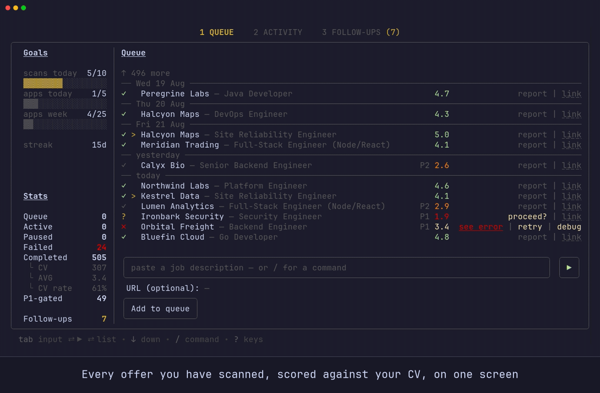
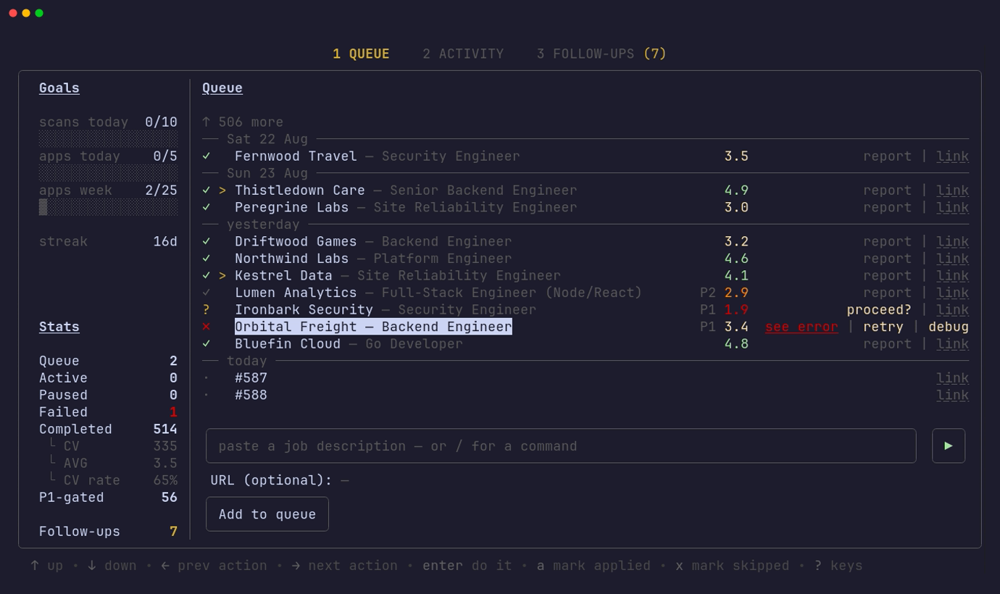
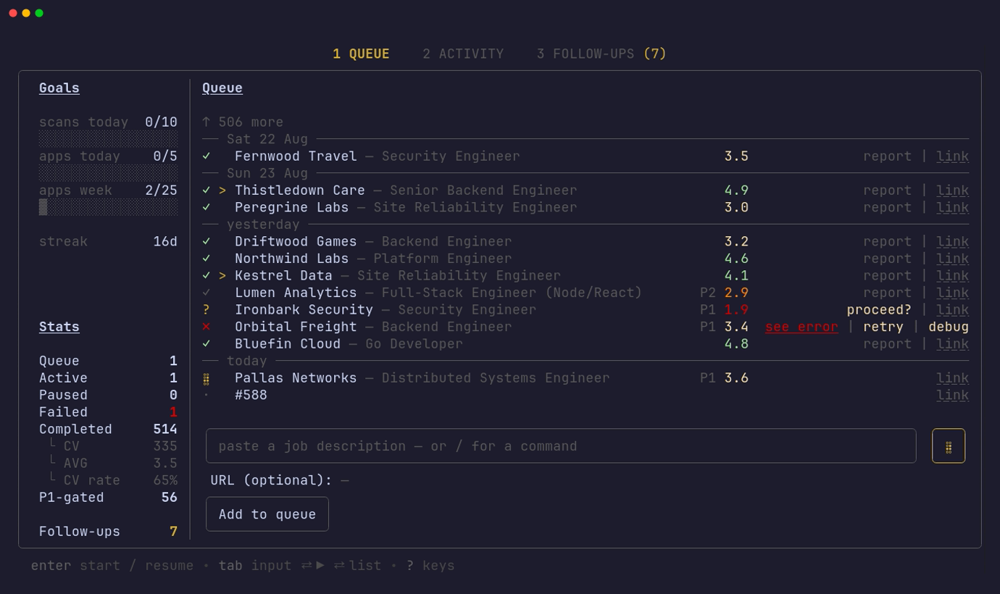
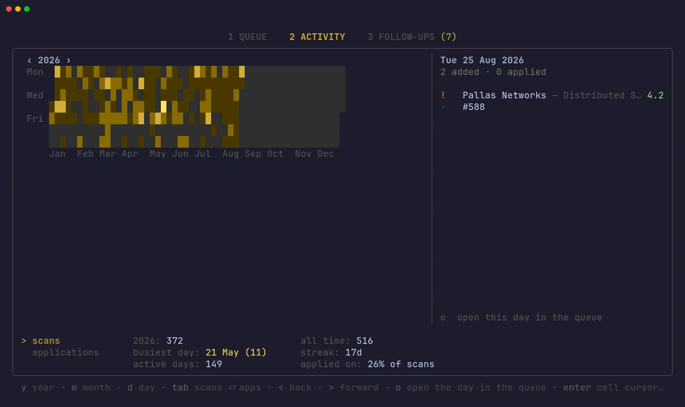
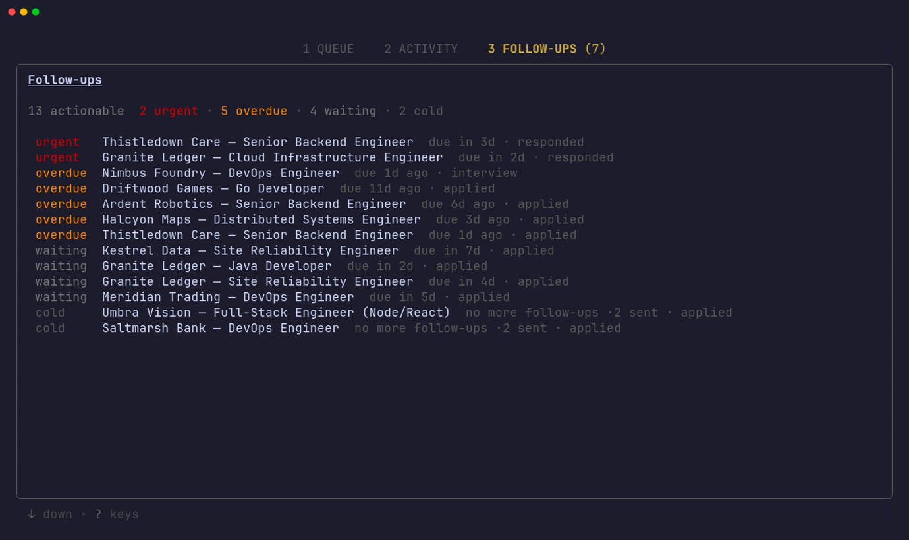

```
 ███████╗███╗   ██╗██╗██████╗ ███████╗
 ██╔════╝████╗  ██║██║██╔══██╗██╔════╝
 ███████╗██╔██╗ ██║██║██████╔╝█████╗
 ╚════██║██║╚██╗██║██║██╔═══╝ ██╔══╝
 ███████║██║ ╚████║██║██║     ███████╗
 ╚══════╝╚═╝  ╚═══╝╚═╝╚═╝     ╚══════╝
local AI job search · driven from your terminal
```

# snipe-cli

[](https://github.com/dsk1ra/snipe-cli/actions/workflows/ci.yml)
[](LICENSE)


Paste a job description. snipe scores it against your CV, writes a full fit
report, and tailors a one-page PDF for the roles worth your time. You drive all
of it from the **snipe TUI**, a dashboard that lives in your terminal.

snipe is a single Go binary. It was a Node project through v0.4.0 and was
ported component by component, each one checked against the original over a
corpus of real postings before the original was removed.

What is left of Node is the oracle those checks run against and the benchmark
harness that measured the pipeline's constants. Neither is on the path of a
run.

Every model call goes to a local [Ollama](https://ollama.com). Your CV, your
applications and your reports never leave the machine.

snipe drafts and fills applications. It never submits them; that part stays
yours.



<sub>Paste a posting → pre-score → full report → tailored CV → applied. Sample
data throughout.</sub>

---

## How it works

```
  paste JD ─┐
  /scan  ───┤        Phase 1            Phase 2              Phase 3
  scan   ───┘   ┌──────────────┐  ┌──────────────┐   ┌──────────────────┐
     queue ────►│  pre-score   │─►│   evaluate   │──►│   tailor CV +    │──► output/
                │ snipe-screen │  │  snipe-eval  │   │   snipe-cv → PDF │    *.pdf
                └──────────────┘  └──────────────┘   └──────────────────┘
                   score ≥ 2.5?      full report        score ≥ 3.0?
                                  reports/NNN-*.md
```

| Phase | Model | Output |
|-------|-------|--------|
| 1 · pre-score | `snipe-screen` (Qwen3 4B) | `batch/scores/<id>.json` |
| 2 · evaluate | `snipe-eval` (Qwen3 30B-A3B) | `reports/<NNN>-<slug>-<date>.md` |
| 3 · tailor CV | `snipe-cv` (Qwen2.5 7B Coder) | `output/<date>_<slug>_<NNN>/` (PDF) |

`snipe-embed` (Qwen3 Embedding 0.6B) does the evidence matching in Phase 2 and
the bullet selection in Phase 3. Scores run 0–5. Below 3.0 the verdict is Skip, and an Apply
under 3.5 is downgraded to Consider, so a marginal posting never reads as a
recommendation.

Phase 3 writes no bullets of its own. They reach the page worded as `cv.md` words
them, ranked by embedding against the posting's requirements and reranked by
`snipe-eval`; deleting that rewrite call measured better than keeping it, and
better than swapping in a larger model. The skills block ships the categories a
posting actually named rather than the whole taxonomy, and a density ladder
tightens the layout until the PDF fits one page.

---

## Setup

Go ≥ 1.25 and a local [Ollama](https://ollama.com). The CV renders from LaTeX,
so it needs `pdflatex` on PATH — on Debian/Ubuntu `texlive-latex-recommended`,
`texlive-latex-extra` and `texlive-fonts-recommended`; on Fedora
`texlive-scheme-medium`. A GPU helps but isn't required, see
[Hardware](#hardware).

Node ≥ 18 is optional and only for the gates and the benchmark sweeps. Nothing
in a normal run touches it.

```bash
cp config/profile.example.yml config/profile.yml   # comp, location, scoring policy
cp config/profile.template.md  config/profile.md   # archetypes + narrative
cp templates/portals.example.yml portals.yml       # portals to scan (optional)
cp .env.example .env                               # API keys (optional)
# add your cv.md at the project root (article-digest.md too, if you have one)
```

`.env` only matters for portal scanning. `APIFY_API_KEY` unlocks the Apify-backed
providers (LinkedIn, Indeed, Glassdoor); without a key those sit out and
everything else, the whole pipeline included, runs as normal. The key is read
into the environment at startup and sent as a bearer token, never in a URL.

Build the four models once, then start the server with a q8_0 KV cache or the
30B's context will not fit:

```bash
ollama pull qwen3:4b-instruct-2507-q8_0
ollama pull qwen3:30b-a3b-instruct-2507-q4_K_M
ollama pull qwen2.5-coder:7b-instruct-q5_K_M
ollama pull qwen3-embedding:0.6b-q8_0

ollama create snipe-screen -f prompts/Modelfile.snipe-screen
ollama create snipe-eval   -f prompts/Modelfile.snipe-eval
ollama create snipe-cv     -f prompts/Modelfile.snipe-cv
ollama create snipe-embed  -f prompts/Modelfile.snipe-embed

OLLAMA_KV_CACHE_TYPE=q8_0 ollama serve
```

```bash
```

---

## Using the TUI

```bash
go build -o bin/snipe ./cmd/snipe && ./bin/snipe
```

Once a second it re-reads what's on disk: the queue, the scores, the evals, the
output. So you can start a run, watch it move, and keep adding jobs while it
works. It never edits pipeline state itself. The only files it writes are its own
sidecars under `batch/state/`: `applied.tsv`, `skipped.tsv` and the
declined-gate list, plus `batch/errors/<id>.txt`.

<table>
<tr>
<td width="50%"><a href="demo/screens/queue.png"></a><br>
<b>Queue</b> — one line per offer: the score, where it stopped, and the actions
that row still has. A gated offer asks <code>proceed?</code>; a failed one
carries <code>see error · retry · debug</code>.</td>
<td width="50%"><a href="demo/screens/running.png"></a><br>
<b>A run in flight</b> — rows move through <code>scoring… → evaluating… →
tailoring CV…</code> while you keep queueing. The run is a detached process, so
quitting the TUI does not stop it.</td>
</tr>
<tr>
<td><a href="demo/screens/activity-year.png"></a><br>
<b>Activity</b> — every scan you have run, one square a day, gold on your
busiest. <code>y m d</code> zoom from the year to a single day by hour;
<code>tab</code> swaps the grid to applications sent.</td>
<td><a href="demo/screens/followups.png"></a><br>
<b>Follow-ups</b> — who is owed a nudge, worked out from the tracker.
<code>Enter</code> records one, <code>p</code> advances the status,
<code>r</code> ends it with five seconds to undo.</td>
</tr>
</table>

<sub>Click any shot for full size. The whole session end to end, with captions:
**[snipe-demo.mp4](demo/snipe-demo.mp4)** (3:48).</sub>

**Adding a job.** Paste into the box (**/** jumps into it from anywhere on the
tab), then **Enter** walks the mini-form: JD → URL → Add to queue. **→** from the
box focuses **▶**, and Enter there runs the queue; results land in `reports/` and
`output/` as the counters tick up. Start a run whenever you like — anything you
add while one is active waits its turn and gets picked up at the end.

`/scan` typed in the same box runs the zero-token portal scanner and queues
whatever new roles it finds.

**When a job fails**, the row carries its own actions. **→** focuses each one and
**Enter** fires it:

```
  ✗ Company — Role  see error  retry | debug
```

**see error** opens `batch/errors/<id>.txt`, the untruncated failure text.
**debug** opens the input that phase actually read (the fetched JD, or the Phase
2 report) so you can fix it in place. **retry** then re-runs all three phases over
the top of the last attempt. Expired and blocked postings show no retry at all,
since re-running cannot recover them.

**When the pre-screen says no**, the offer never reaches the 30B evaluator. That
gate is a cost heuristic over a 4B pre-score rather than a verdict, so the row
lets you overrule it, and it shows the score that gated it because how close it
came is the whole input to the decision:

```
  · Company — Role  P1 2.0 | proceed?  link
```

**y** or **Enter** re-runs that one offer with the gate off. Nothing is
re-scored: the pre-score and the fetched JD are already on disk, so the run picks
up at Phase 2, and Phase 3 follows if the real evaluation clears the threshold.
**n** or Backspace dismisses the question instead, which changes nothing in the
pipeline (the row had already finished) and is recorded in
`batch/p1-declined.tsv`. Deleting that line brings the question back.

<details>
<summary><b>Every key</b> — the same reference <code>?</code> shows in the app</summary>

| Key | Action |
|-----|--------|
| **←/→** or **1/2/3** | Switch tabs |
| **↑/↓** | Walk every element top-to-bottom (tab → list → JD → URL → Add); ↑ past the top returns to the tab bar |
| **→** | Hop from the JD box to **▶**; on a list row, walk its inline actions (the link, **see error · retry · debug** on a failed row, **proceed?** on a P1-gated one) |
| **Tab / Shift-Tab** | Cycle input ↔ ▶ ↔ list |
| **Enter** | Advance the JD → URL → Add form (enqueues); on a focused row action, fire it |
| **o** | Open the result folder / report |
| **a** | Mark the selected row **applied `>`** |
| **x** | Mark the selected row **skip `-`** (mutually exclusive with applied) |
| **r** · **p** · **u** | Follow-ups tab only: end the entry as *Rejected* (5 s to change your mind), advance it a stage, or undo — the pending rejection first, then the last nudge |
| **y** · **n** | On a focused **proceed?**: evaluate the gated offer anyway, or dismiss the gate |
| **?** | The full key reference, as an overlay; the next keypress closes it |
| **/** | Start a slash command |
| **Esc** | Clear the field / step out |
| **q** | Quit (when not inside an input field) |

</details>

---

## Command line

You don't need the TUI. Every command works standalone:

```bash
./bin/snipe add -jd "<paste JD text>"    # add one JD and run it
./bin/snipe add -f job.txt -link <url>   # same, JD read from a file
./bin/snipe add -queue "<text>"          # queue only, don't run yet
./bin/snipe run                          # process everything queued
./bin/snipe scan                         # scan the configured boards
./bin/snipe status                       # what is running, and where
./bin/snipe stop                         # stop after the current stage
./bin/snipe pause                        # drop the stage in flight; resume reruns it
./bin/snipe doctor                       # setup, state and tracker integrity
./bin/snipe tracker fix                  # canonical statuses, one row per opening
```

Run any subcommand with `-h` for its flags.

---

## Hardware

Developed on an RTX 3060 6 GB with 30 GB of RAM. Phases 1 and 3 fit entirely on
the GPU; the 30B MoE evaluator auto-splits between GPU and RAM. Smaller and
CPU-only setups work too — point the phases at lighter models with
`--phase2-model` and friends.

## Tracker

`data/applications.md` is the source of truth for everything you've evaluated,
applied to, or skipped. Runs merge into it automatically, and the FOLLOW-UPS tab
reads its cadence from there. Runs merge into it automatically. Editing an existing row's status or note is
fine.

```bash
./bin/snipe doctor          # setup, state and tracker integrity
./bin/snipe tracker fix     # canonical statuses, one row per opening, working links
```

## Tests

```bash
go test ./...          # must stay green; this is what CI runs
```

The tests needing Ollama, `pdflatex` or a real `cv.md` skip themselves, which on
a runner is always.

Beyond them, `cmd/gate` diffs this implementation against the Node original over
a corpus of real postings. That is what proved the port, and it still runs: the
oracle it compares against is the one part of the Node code that was kept.

```bash
npm install            # js-yaml, nothing else
npm run gate:fit       # 351 of 351 identical
npm run gate:salary    # 351 of 351
npm run gate:cleanjd   # 351 of 351
npm run gate:atoms     # 68 of 68
```

They are not in CI because they need the cached JD corpus and a real `cv.md`,
both user data that is never committed. A gate agreeing with Node is not the
same as being right, so `go run ./cmd/gate goldset` asks a human instead.

Coverage counts every `.mjs` file, including the ones the suite never loads, so
no exclusion flatters the number. None of it needs a GPU, a terminal or the
network: the Ollama-driven phases run for real against a stand-in model server,
the TUI is driven headlessly through a fake TTY, and the portal scanner and job
providers get a fixture and a stub transport.

## Data & privacy

Everything personal stays on your machine and is gitignored. Only the system
layer — scripts, modes, templates — is tracked:

- **What you wrote** — `cv.md`, `article-digest.md`, `config/profile.*`,
  `portals.yml`, `.env`
- **What the pipeline produced** — `data/`, `reports/`, `output/`,
  `interview-prep/`, and the working artifacts that are easy to overlook:
  `batch/jds/` (full text of every JD fetched), `batch/scores/`, `batch/evals/`,
  `batch/errors/`, `batch/logs/`, and the run state under `batch/state/`
- **Derived copies of your CV**, personal for the same reason `cv.md` is:
  `batch/state/cv-bank.json` holds the source text of every bullet, while
  `batch/cache/cv-index.json` and `batch/cache/cv-spike.json` hold its
  embeddings. The split is by what you lose if it is gone, which is what makes
  `rm -rf batch/cache` safe to type and `batch/state/` not

Outbound traffic is limited to the job boards and APIs you configure yourself.
Every model call goes to Ollama on localhost.

## License

MIT — see [`LICENSE`](LICENSE).

---

Deeper reading: [`batch/CLAUDE.md`](batch/CLAUDE.md) for the measured constants
and why each is that number · [`docs/README.md`](docs/README.md) for the measurement ledgers ·
[`docs/SETUP.md`](docs/SETUP.md) · [`docs/ARCHITECTURE.md`](docs/ARCHITECTURE.md) ·
[`docs/CUSTOMIZATION.md`](docs/CUSTOMIZATION.md)

The ledgers under `docs/` are historical records of what was measured when.
They name Node files that no longer exist here, which is correct: that is the
code the measurements were taken against. `oracle/node-complete` is the tag that
still has them.
